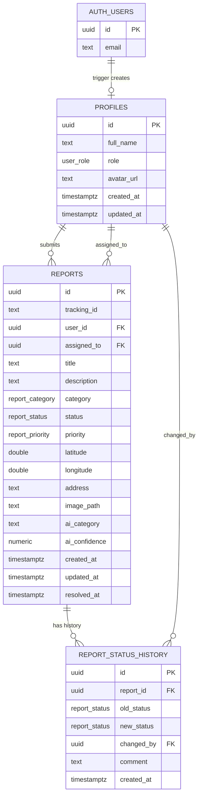

# Database Schema — CivicFix Supabase Integration

**Migration file:** `supabase/migrations/20261018000000_initial_schema.sql`

---

## 1. Enum Types

| Enum | Values |
|---|---|
| `user_role` | `citizen`, `officer`, `admin` |
| `report_category` | `road`, `sanitation`, `drainage`, `water`, `electricity`, `other`, `pothole`, `garbage`, `streetlight` |
| `report_status` | `submitted`, `under_review`, `in_progress`, `resolved`, `rejected` |
| `report_priority` | `low`, `medium`, `high`, `urgent` |

---

## 2. Tables

### `profiles`
One row per Supabase Auth user. Auto-created by the `on_auth_user_created` trigger.

| Column | Type | Constraints | Notes |
|---|---|---|---|
| `id` | `uuid` | PK, FK → `auth.users(id)` ON DELETE CASCADE | Matches Auth user ID |
| `full_name` | `text` | NOT NULL DEFAULT `'Citizen'` | |
| `role` | `user_role` | NOT NULL DEFAULT `'citizen'` | Cannot be self-escalated via RLS |
| `avatar_url` | `text` | nullable | |
| `created_at` | `timestamptz` | NOT NULL DEFAULT `now()` | |
| `updated_at` | `timestamptz` | NOT NULL DEFAULT `now()` | Auto-maintained by trigger |

### `reports`
Core civic issue report.

| Column | Type | Constraints | Notes |
|---|---|---|---|
| `id` | `uuid` | PK DEFAULT `uuid_generate_v4()` | Internal DB key |
| `tracking_id` | `text` | UNIQUE NOT NULL | `CIV-XXXXXXXX` format, non-sequential |
| `user_id` | `uuid` | FK → `profiles(id)` ON DELETE SET NULL, nullable | Null = anonymous |
| `title` | `text` | NOT NULL, 3–200 chars | |
| `description` | `text` | NOT NULL, ≥10 chars | |
| `category` | `report_category` | NOT NULL DEFAULT `'other'` | |
| `status` | `report_status` | NOT NULL DEFAULT `'submitted'` | |
| `priority` | `report_priority` | NOT NULL DEFAULT `'medium'` | |
| `latitude` | `double precision` | NOT NULL | |
| `longitude` | `double precision` | NOT NULL | |
| `address` | `text` | nullable | Reverse-geocoded from coords |
| `image_path` | `text` | nullable | Supabase Storage object path |
| `ai_category` | `text` | nullable | AI-suggested category |
| `ai_confidence` | `numeric(5,2)` | nullable, 0–100 | |
| `assigned_to` | `uuid` | FK → `profiles(id)` ON DELETE SET NULL | Officer/admin assigned |
| `created_at` | `timestamptz` | NOT NULL DEFAULT `now()` | |
| `updated_at` | `timestamptz` | NOT NULL DEFAULT `now()` | Auto-maintained by trigger |
| `resolved_at` | `timestamptz` | nullable | Set when status → `resolved` |

**Indexes:** `user_id`, `status`, `category`, `tracking_id`, `(latitude, longitude)`, `created_at DESC`

### `report_status_history`
Immutable audit trail. No UPDATE or DELETE is permitted.

| Column | Type | Constraints | Notes |
|---|---|---|---|
| `id` | `uuid` | PK DEFAULT `uuid_generate_v4()` | |
| `report_id` | `uuid` | NOT NULL FK → `reports(id)` ON DELETE CASCADE | |
| `old_status` | `report_status` | nullable | Null on initial insert |
| `new_status` | `report_status` | NOT NULL | |
| `changed_by` | `uuid` | FK → `profiles(id)` ON DELETE SET NULL | |
| `comment` | `text` | nullable | |
| `created_at` | `timestamptz` | NOT NULL DEFAULT `now()` | |

---

## 3. Triggers

| Trigger | Table | Event | Function | Purpose |
|---|---|---|---|---|
| `on_auth_user_created` | `auth.users` | AFTER INSERT | `handle_new_user()` | Auto-creates `profiles` row with `role = 'citizen'` |
| `on_report_created` | `reports` | AFTER INSERT | `handle_new_report()` | Auto-inserts initial `submitted` history entry |
| `on_report_status_change` | `reports` | AFTER UPDATE OF status | `handle_report_status_change()` | Auto-inserts history row on every status transition |
| `update_reports_updated_at` | `reports` | BEFORE UPDATE | `update_updated_at_column()` | Keeps `updated_at` current |
| `update_profiles_updated_at` | `profiles` | BEFORE UPDATE | `update_updated_at_column()` | Keeps `updated_at` current |

---

## 4. Row Level Security Policies

### `profiles`

| Policy | Operation | Rule |
|---|---|---|
| `profiles_select_public` | SELECT | `true` — anyone can read profiles |
| `profiles_insert_own` | INSERT | `auth.uid() = id` |
| `profiles_update_own` | UPDATE | `auth.uid() = id` AND `role` unchanged (prevents self-escalation) |
| `profiles_update_admin` | UPDATE | `is_admin()` — admins can change any profile including role |

### `reports`

| Policy | Operation | Rule |
|---|---|---|
| `reports_select_public` | SELECT | `true` — public transparency |
| `reports_insert_authenticated` | INSERT | `auth.role() = 'authenticated'` AND `user_id = auth.uid() OR user_id IS NULL` |
| `reports_update` | UPDATE | `auth.uid() = user_id` OR `is_officer_or_admin()` |
| `reports_delete_admin` | DELETE | `is_admin()` only |

### `report_status_history`

| Policy | Operation | Rule |
|---|---|---|
| `rsh_select_public` | SELECT | `true` — tracking transparency |
| `rsh_insert_officers` | INSERT | `is_officer_or_admin()` only |
| No UPDATE or DELETE policies | — | Immutable audit trail |

---

## 5. Helper Functions

| Function | Returns | Purpose |
|---|---|---|
| `is_officer_or_admin()` | `boolean` | True if current user's profile.role is officer or admin |
| `is_admin()` | `boolean` | True if current user's profile.role is admin |

Both are `SECURITY DEFINER` — they read profiles with elevated permission so RLS on profiles doesn't block them.

---

## 6. Storage Bucket

**Bucket name:** `report-images`

| Setting | Value |
|---|---|
| Access | Private (signed URLs required) |
| Max file size | 5 MB |
| Allowed MIME types | `image/jpeg`, `image/png`, `image/webp` |
| Object path pattern | `{user_id}/{timestamp}-{random}.{ext}` |

Storage RLS policies (apply after creating the bucket in Dashboard):

```sql
-- Users upload to their own folder only
create policy "storage_upload_own" on storage.objects for insert
  with check (bucket_id = 'report-images' and auth.role() = 'authenticated'
              and (storage.foldername(name))[1] = auth.uid()::text);

-- Owners and officers/admins can read
create policy "storage_select_own_or_officer" on storage.objects for select
  using (bucket_id = 'report-images'
         and ((storage.foldername(name))[1] = auth.uid()::text or public.is_officer_or_admin()));

-- Owners can delete their own images
create policy "storage_delete_own" on storage.objects for delete
  using (bucket_id = 'report-images'
         and (storage.foldername(name))[1] = auth.uid()::text);
```

---

## 7. Entity Relationship Diagram


